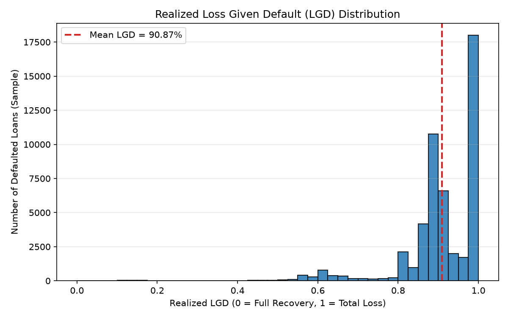
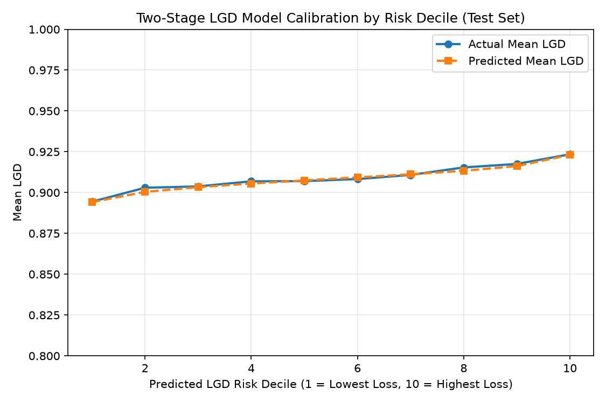
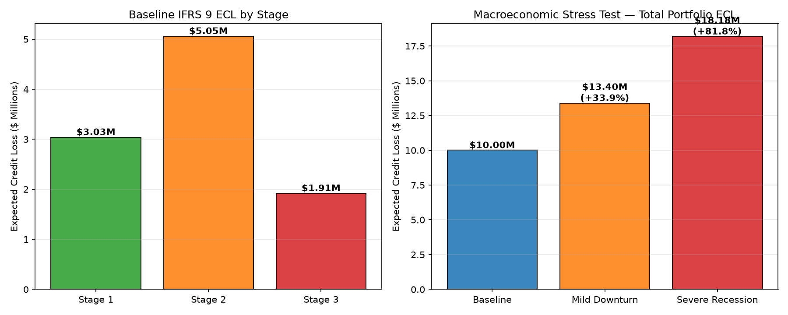

# Two-Stage LGD Model & IFRS 9 Expected Credit Loss (ECL) Engine

An end-to-end credit risk modeling and regulatory provisioning pipeline built in **SQL (DuckDB)** and **Python**. Using 268,404 historical defaulted loans and an active portfolio of 9,505 exposures (USD 98.69M EAD) from Lending Club, the project implements a banking-standard **Two-Stage (Hurdle) Loss Given Default** model, assigns **IFRS 9 Stages (Stage 1 / 2 / 3)** under Significant Increase in Credit Risk (SICR) triggers, and quantifies reserve sensitivity under **macroeconomic stress scenarios**.

---

## Project Architecture & Pipeline

```text
ifrs9-lgd-ecl-engine/
├── data/                       # Local DuckDB database & raw CSV (ignored in Git)
├── reports/                    # Generated calibration charts & IFRS 9 summary tables
│   ├── lgd_distribution.png
│   ├── lgd_calibration.png
│   ├── ifrs9_ecl_stress.png
│   ├── ifrs9_stage_summary.csv
│   └── macro_stress_results.csv
├── src/
│   ├── 01_ingest.py            # Out-of-core CSV ingestion & portfolio filtering in DuckDB
│   ├── 02_clean_eda.py         # SQL LGD target engineering & bimodal distribution analysis
│   ├── 03_lgd_model.py         # Two-Stage Hurdle LGD model (Classifier + Severity Regressor)
│   └── 04_ifrs9_ecl_stress.py  # IFRS 9 staging, ECL calculation & macro stress testing
├── .gitignore
├── requirements.txt
└── README.md
```

---

## 1. Realized LGD Engineering & Distribution

For defaulted loans (`Charged Off`), Exposure at Default (**EAD**) and net recovery after collection fees are computed directly in DuckDB:

$$\text{LGD} = \text{clip}\left(1 - \frac{\max(0, \text{Recoveries} - \text{Collection Fee})}{\text{Funded Amount} - \text{Principal Recovered}}, \; 0, \; 1\right)$$

* **Portfolio Sample:** 268,404 historical defaults (average EAD = **USD 11,175.61**)
* **Mean Realized LGD:** **90.87%** (Median: **91.54%**)
* **Zero-Recovery Rate (LGD = 100%):** **31.22%** of defaulted borrowers generated zero net post-default recovery, creating a classic bimodal / boundary-inflated distribution typical of unsecured consumer credit.



---

## 2. Two-Stage (Hurdle) LGD Model

Because standard OLS regression fails to capture the probability mass at `LGD = 1.0`, a two-stage hurdle architecture is calibrated on an 80/20 stratified split:

1. **Stage 1 (Zero-Recovery Classifier):** Regularized Logistic Regression estimating $P(\text{LGD} = 1 \mid X)$.
2. **Stage 2 (Conditional Severity Regressor):** Histogram-Based Gradient Boosting Regressor estimating $E[\text{LGD} \mid \text{LGD} < 1, X]$ on partial-recovery accounts.
3. **Combined Expected LGD:**

$$\widehat{\text{LGD}}_i = \hat{p}_i \cdot 1.0 + (1 - \hat{p}_i) \cdot \widehat{\text{LGD}}_{i, \text{conditional}}$$

| Out-of-Sample Metric (Test Set) | Value |
| :--- | :---: |
| **Actual Mean LGD** | **0.9090** |
| **Predicted Mean LGD** | **0.9084** |
| **Combined RMSE** | **0.1100** |
| **Combined MAE** | **0.0731** |
| **Stage 1 Zero-Recovery ROC AUC** | **0.5659** |



---

## 3. IFRS 9 Staging & Macroeconomic Stress Testing

The calibrated LGD model is applied to an active portfolio of **9,505 loans** (**USD 98.69M Total EAD**). Exposures are allocated across IFRS 9 stages using SICR triggers (`delinq_2yrs >= 1`, `FICO < 670`, or `DTI > 32%`) to compute $\text{ECL} = \text{PD} \times \text{LGD} \times \text{EAD}$:

### Baseline IFRS 9 Portfolio Breakdown

| IFRS 9 Stage | Horizon | Loans | Total EAD ($) | Avg PD | Avg LGD | Baseline ECL ($) | Share of Total ECL |
| :--- | :---: | :---: | :---: | :---: | :---: | :---: | :---: |
| **Stage 1** (Performing) | 12-Month | 6,195 | $65,938,575.98 | 4.86% | 91.08% | $3,034,977.66 | 30.34% |
| **Stage 2** (SICR Triggered) | Lifetime | 3,066 | $30,634,262.21 | 15.87% | 90.92% | $5,054,171.55 | 50.52% |
| **Stage 3** (Impaired) | Lifetime | 244 | $2,118,901.96 | 100.00% | 90.12% | $1,914,330.69 | 19.14% |
| **Total Portfolio** | — | **9,505** | **$98,691,740.15** | — | — | **$10,003,479.90** | **100.00%** |

### Macroeconomic Stress Scenarios

| Scenario | Stress Shock Assumptions | Total ECL ($) | ECL Coverage Ratio | Reserve Uplift vs. Baseline |
| :--- | :--- | :---: | :---: | :---: |
| **Baseline** | Current macroeconomic conditions | $10,003,479.90 | 10.14% | 0.00% |
| **Mild Downturn** | PD × 1.35, LGD +4 pp | $13,397,461.49 | 13.58% | **+33.93%** |
| **Severe Recession** | PD × 1.85, LGD +8 pp | $18,182,379.86 | 18.42% | **+81.76%** |



---

## How to Run

1. Place the Lending Club dataset (`accepted_2007_to_2018Q4.csv`) inside `data/` as `data/lending_club.csv`.
2. Install dependencies and execute the pipeline sequentially:
   ```bash
   pip install -r requirements.txt
   cd src
   python 01_ingest.py
   python 02_clean_eda.py
   python 03_lgd_model.py
   python 04_ifrs9_ecl_stress.py
   ```